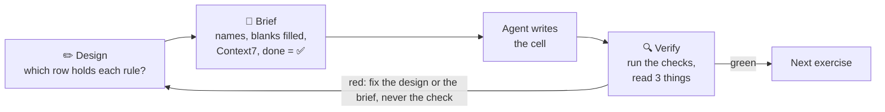

# Coding with an agent

This repo comes set up for a coding agent. You decide what to build. The agent types it. You check it.
This page shows where that line sits, and how to check the agent's work without trusting it.

## 1. Why work this way

You still **read** agent code. The notebooks teach you to. You don't need to **type** all of it.

Draw the line at the Pydantic AI objects:

- **Above the line is yours:** which objects exist, what each one may see, do, spend and remember, how they
  connect, and what proves it works.
- **Below the line is the agent's:** how each object is spelled.

Write it by hand when it is three lines, or when you meet an idea for the first time. Delegate when you know
what you want and you can check it.

## 2. The loop



The three things to read: the pytest result, the Verify cell's output (✅ or ⏳), and the diff.

## 3. Own it: decide before you brief

**The row each rule lives in.** This is the map from notebook 14:

| A rule that says… | Lives in | Met in |
|---|---|---|
| how to talk, what to do first | `instructions` | 01, 05 |
| what shape the answer has, what it must never say | `output_type` + an output validator | 03 |
| which tools it may see, maybe per user | a `.filtered` toolset | 09 |
| check, log or block a tool call | a `Hooks` guardrail | 10 |
| a person must say yes first | `requires_approval` | 10 |
| how much one job may spend | `UsageLimits` | 10, 11 |
| how much of the chat it remembers | message history + `ProcessHistory` | 07, 13 |

The costlier a broken rule, the more it belongs in code. Only the first row is a request. A model can ignore a
request. It cannot talk its way past code.

Decide these too:

- **Names and shapes.** What each object is called, and the fields of each type. The Verify cell checks names.
- **Every word the model reads.** Instructions and tool docstrings are prompts (04). Write them yourself.
- **Scope.** Which tools, for whom, what needs a yes, and the budget number (09–11).
- **Memory.** What the model sees, and what you store (07, 13).
- **What "done" means.** Which assert or eval proves it (08, 12).
- **Model choice and spend** (02).

## 4. Delegate it

Hand these to the agent: imports, decorators and boilerplate; `uv add`, installs and config; JSON, SQL and
HTTP plumbing; `FunctionModel` scripts; `Dataset` and `Case` boilerplate; formatting.

Make the agent look APIs up in Context7, not in its memory. Its memory of Pydantic AI is older than v2.

## 5. Verify it

Each question has a check. All but the last run without a key:

| Question | How | Notebook |
|---|---|---|
| What was it offered? | `TestModel(call_tools=[])`, then `last_model_request_parameters.function_tools` | 04, 08, 09, 14 |
| What was it told? | the request's `.instructions`, or `info.instructions` in a `FunctionModel` | 05, 10, 14 |
| What shape comes back? | `output_type` | 03 |
| Do the fences hold? | `DeferredToolRequests`, `UsageLimitExceeded`, the hook's log | 10 |
| Who pays? | `result.usage.requests` counts sub-agents too | 11, 14 |
| What is remembered? | count the stored messages | 07, 13 |
| Does the steering work? | eval scores, compared with `baseline=` | 12 |
| Did anything paid run? | `models.override_allow_model_requests(False)` | 08 |
| Live, and optional | a Logfire trace | 06 |

## 6. Read it, don't write it

Skim the agent's diff for these, and only these:

- It builds on `MODEL` (or the notebook's `TestModel()` stand-in), never a typed model name.
- Every instruction and docstring, word for word.
- Clients or lists at module level that should be deps.
- Sub-agent calls carry `usage=ctx.usage`.
- New files, dependencies or helper classes. Ask why.
- SQL built with an f-string.
- Any check that was edited or deleted.

## 7. Don't bother

None of these change what the agent does: memorising signatures or import paths, a loop versus a
comprehension, local variable names, how a comment is worded, import order, or the exact words of a model's
answer. Let them go.

## 8. Loud mistakes and silent ones

A **loud** mistake crashes with an error. You can't miss it. A **silent** one runs, looks fine, and is wrong.
Spend your attention on the silent ones. Agents make these often:

| Mistake | Loud or silent | What catches it |
|---|---|---|
| v1 code: `result.data`, `result.usage()` | loud | the error message |
| `system_prompt=` instead of `instructions=` | silent | read the diff (01) |
| `run_sync()` or `asyncio` | loud | the error, and `scripts/check_notebooks.py` |
| a typed or invented model name | silent | assert it equals `MODEL`; `pydantic_ai.models.known_model_names()` lists real ones |
| a hard rule left only in instructions | silent | a test that breaks the rule (04, 10) |
| globals instead of deps | silent | two runs with different deps (05, 10) |
| a sub-agent call without `usage=ctx.usage` | silent | `result.usage.requests` (11, 14) |
| storing `all_messages()` | silent | count the stored messages (07, 13) |
| a tool deleted instead of filtered | silent | the offered tools, per role (09) |
| SQL built with an f-string | silent | look for `?` placeholders (13) |
| a real model in an offline test | loud, under the kill switch | `override_allow_model_requests(False)` (08 on) |
| an edited Verify cell, or a test that can't fail | silent | `git diff`, and break it on purpose |
| helpers, classes or dependencies nobody asked for | silent | read the diff |
| `logfire.configure()` added | silent | read the diff: `setup()` already does it |
| `instrument=`, `MCPServerStdio`, `history_processors=` | loud | the error; the README's old-tutorial table |

**Break it on purpose.** Undo one line of the agent's work and run the check again. If it stays green, it was
not checking that line.

## 9. Anatomy of a brief

A good brief has five parts:

1. **Follow AGENTS.md.**
2. **The objects,** by exact name, with every `<…>` blank from your design filled in.
3. **Look up** the named APIs in Context7.
4. **Where:** one cell above the Verify cell. No helpers. Never edit the Verify cell.
5. **Done:** `uv run pytest notebooks/NN_name.ipynb` passes **and** the named objects exist.

An example (an illustration, not a real exercise):

```text
Follow AGENTS.md. In notebooks/09_toolsets_and_mcp.ipynb, add one cell directly above "# 🔍 Verify".
Build `Shopper`, a dataclass with one field, `role: str`.
Build `refund_tools`, a FunctionToolset with two plain-def tools:
- `lookup_order(order_id: int) -> str`, docstring "Look up one order by its number."
- `issue_refund(order_id: int) -> str`, docstring "Refund an order. Staff only."
Build `refund_desk`, an Agent on TestModel() with deps_type=Shopper and the toolset
refund_tools.filtered(...), so `issue_refund` is offered only when ctx.deps.role == "staff".
Look up FunctionToolset and .filtered in Context7 first. No helpers. Never edit the Verify cell.
Done: `uv run pytest notebooks/09_toolsets_and_mcp.ipynb` passes, and `Shopper`, `refund_tools` and
`refund_desk` exist. Report each command you ran and what it printed.
```

## 10. Set up once

- **Claude Code** reads [`AGENTS.md`](../AGENTS.md) through `CLAUDE.md`, which holds one line: `@AGENTS.md`.
- **Context7** ships in [`.mcp.json`](../.mcp.json). It needs no key (a free key raises its rate limit). Claude
  Code asks you to approve it once. To undo that choice, run `claude mcp reset-project-choices`.
- **Pydantic's `ai` skills** turn on when you trust the folder. [`.claude/settings.json`](../.claude/settings.json)
  adds the `pydantic-skills` marketplace. Run `/plugin` to see it.
- **Optional, Logfire:** run `claude plugin install logfire@pydantic-skills`, then `/logfire:connect` inside
  Claude Code. Your agent can then read your traces. It needs a Logfire login. If the install can't find the
  marketplace, run `claude plugin marketplace add pydantic/skills` first.
- **Other agents** (Codex, Cursor, Copilot) read `AGENTS.md` too. Add `https://mcp.context7.com/mcp` as an HTTP
  MCP server in their settings, or give them https://pydantic.dev/docs/ai/llms.txt.
- **Work on your own branch:** `git switch -c my-work`.
- **JupyterLab:** save the notebook before the agent edits it. Afterwards, use File → Reload Notebook from Disk,
  then Run → Run All Cells.

## 11. Sources

- [Claude Code best practices](https://code.claude.com/docs/en/best-practices): "give Claude a check it can run"
- [Anthropic: 2026 Agentic Coding Trends Report](https://resources.anthropic.com/2026-agentic-coding-trends-report)
- [Pydantic: coding-agent skills](https://pydantic.dev/docs/ai/overview/coding-agent-skills/)
- [agents.md](https://agents.md)
- [Context7](https://context7.com)
